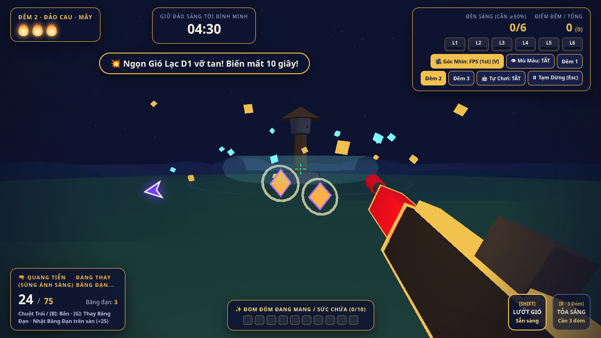

# Đảo Đèn Lồng — Day 12 AI SDLC (3D Anime Edition · Release v1.0.0 · Contract v1.3)

> **Học viên:** Nguyễn Đức Đạt · **MSSV:** `2A202603544` · **Lớp:** `L3A`
> **Phiên bản phát hành:** `v1.0.0` (`tag: phase-4` · **Test Contract v1.3**)

Game 3D góc nhìn thứ nhất / thứ ba phong cách **Anime Cel-Shading** (Three.js + Anime.js) qua **3 Đêm (Đảo Bến, Đảo Cau, Đảo Chuông)** kết hợp lõi mô phỏng **60 tick/giây tất định (Deterministic Headless Core)** bằng Python 3 Standard Library.



---

## 1. Yêu Cầu Hệ Thống & Cài Đặt (Tối đa 3 lệnh)

- **Yêu cầu hệ thống:** `Python >= 3.10` (chỉ dùng Python Standard Library — `0 pip install`, `0 npm install`) và một trình duyệt web hỗ trợ WebGL (Chrome, Firefox, Edge, Safari).
- **Clone sạch và chạy ngay trong 3 lệnh:**

```bash
# 1. Kiểm tra biên dịch / cú pháp (build_cmd)
python3 -m py_compile headless.py run_game.py bench.py soak.py src/sim.py

# 2. Chạy toàn bộ 26 bài kiểm thử tự động (Phase 1 + 2 + 3 + 4 Contract v1.3)
python3 -m unittest discover -s tests -v

# 3. Mở game 3D trên trình duyệt (run_cmd)
python3 run_game.py
```

### Các lệnh CLI theo Test Contract v1.3 (`headless`, `bench`, `soak`, `--export-leaderboard`)

```bash
# Chạy mô phỏng Headless tất định (JSONL):
python3 headless.py --seed 42 --night 1 --ticks 14400 --out /tmp/night1.jsonl --snapshot-every 60

# Chạy Benchmark chuẩn (200 Bóng Mực, 100 Đom Đóm, 3 đèn L1-L3 sáng fuel 100, khởi động 3s + đo 30s):
python3 bench.py --seed 42 --duration 30 --out bench.json

# Chạy Soak Test độ bền 10 Đêm liên tiếp trong cùng tiến trình:
python3 soak.py --seed 7 --nights 10 --out soak.json

# Xuất Bảng xếp hạng cục bộ Top 10 ra file JSON:
python3 run_game.py --export-leaderboard out.json
```

> **Ghi chú về VSync trong Benchmark:** Trên nền tảng WebGL trình duyệt, tần số quét hiển thị của canvas mặc định gắn với bộ lập lịch khung hình của hệ điều hành (`requestAnimationFrame`). Trình chạy `bench.py` hỗ trợ cờ `--disable-gpu-vsync` khi mở cửa sổ trình duyệt và đo vòng lặp khung hình không khóa trần (`vsync_off: true` trong `bench.json`).

---

## 2. Điều Khiển Trong Game 3D (Hỗ Trợ Đổi Phím Đầy Đủ Trong Cài Đặt)

| Phím Mặc Định | Hành Động (Có thể đổi phím trong `⚙ Cài Đặt & Đổi Phím`) |
|---|---|
| **Click vào màn hình 3D** | **Khóa con trỏ chuột ở giữa màn hình (`Pointer Lock` / `CursorLockMode.Locked`)** để ngắm bắn & xoay camera |
| `W / S / A / D` | Di chuyển 4 hướng (`Tiến lên`, `Lùi xuống`, `Sang trái`, `Sang phải`) kèm hoạt ảnh chạy bộ |
| `Space` | **Nhảy** (`vy = 7.0 m/s`, trọng lực `-20 m/s²`) |
| `Shift` | **Lướt Gió (`Wind Dash`)** — `14 m/s` trong `0.2s` (`12` tick), xoay 360° kèm vòng xoáy gió & tàn ảnh |
| `E` (hoặc `F`) | **Tương tác / Thắp đèn / Châm dầu (`Refuel`)** vào Đèn Lồng gần nhất (`<= 2.0m`) |
| `R` | **Tỏa Sáng (`Pulse`)** — tốn `3` đom đóm, bán kính 3D `5m`, làm choáng Bóng Mực `120` tick & đẩy lùi `4m` |
| `P` (hoặc `Esc`) | **Tạm dừng (`Pause`) & Mở khóa chuột** |
| `Chuột Trái` hoặc `B` | **Bắn Quang Tiễn** vào **Bóng Mực** hoặc **Ngọn Gió Lạc** (3 phát bắn cạn thanh máu → **vỡ tan thành mảnh tinh thể và biến mất 10 giây**, Gió Lạc rơi lại đom đóm đã cướp) |
| `G` | **Nạp Đạn (`Reload Animation`)** — hoạt ảnh nghiêng súng, tháo rơi băng đạn cũ và lắp băng đạn ánh sáng mới |
| `V` | Chuyển đổi góc nhìn **First-Person (FPS)** ↔ **Third-Person (TPS)** |

---

## 3. Tính Năng Nổi Bật Của Bản Phát Hành `v1.0.0` (Phase 1 → Phase 4)

1. **Ba Hòn Đảo & Luật "Đèn Cạn Dầu — Giữ Đảo Sáng Tới Bình Minh":**
   - **Đêm 1 — Đảo Bến (`240s`, 5 đèn)** · **Đêm 2 — Đảo Cau (`270s`, 6 đèn, cầu tre, bục nhảy, Gió Lạc, Bùa Gió)** · **Đêm 3 — Đảo Chuông (`300s`, 7 đèn, 3 tầng cao độ, Tháp Chuông, Cơn Gió Mạnh)**.
   - Đèn sáng tự hao `1.0 fuel/s`; khi `fuel < 30` đèn mất vùng an toàn 6m, nhấp nháy `1 Hz` và bị Bóng Mực áp sát hút dầu (`drain`, `5.0 fuel/s`). Giữ `>= ceil(0.6 * tổng_đèn)` sáng khi bình minh để chiến thắng (`dawn_survived`).
2. **Dễ Tiếp Cận Toàn Diện (Accessibility):**
   - **Đổi phím (Key Remapping):** Đổi phím 9 hành động, phát hiện trùng phím, nút `"↺ Khôi phục mặc định"`.
   - **Phụ đề & Mũi tên chỉ hướng ở mép màn hình:** Cảnh báo trực quan khi Bóng Mực xuất hiện, gió sắp thổi, 10 giây cuối, đèn có `fuel < 30`.
   - **Bảng màu dễ phân biệt (`Colorblind Mode`)**, **Giảm chuyển động (`Reduced Motion`)**, và **Cỡ chữ UI `>= 18px` + Tùy chọn Chữ lớn (`×1.25`)**.
3. **Bảng Xếp Hạng Cục Bộ (`data/leaderboard.json`):**
   - Lưu Top 10 người chơi xuất sắc nhất trên đĩa cục bộ (`name`, `score`, `nights_won`, `achieved_at`, `seed`), xem từ Menu chính hoặc xuất JSON qua `--export-leaderboard`.

---

## 4. Hồ Sơ AI SDLC, Bằng Chứng & Tài Liệu

- [docs/notes/retro.md](docs/notes/retro.md) — **Báo cáo Retrospective tổng kết 4 Phase**, phân tích lỗi AI, hiệu quả Harness và chi phí Token.
- [docs/demo/demo.mp4](docs/demo/demo.mp4) — **Video Demo `.mp4` (< 5 phút)** trình diễn gameplay, benchmark, bảng xếp hạng và accessibility.
- [bench.json](bench.json) & [soak.json](soak.json) — Kết quả đo Benchmark (`116.5 FPS`) và Soak Test 10 Đêm (`0 crashes`).
- [CHANGELOG.md](CHANGELOG.md) — Lịch sử thay đổi qua cả 4 Phase (`v1.0 → v1.1 → v1.2 → v1.3`).
- [docs/notes/phase3-adr-and-spec.md](docs/notes/phase3-adr-and-spec.md) — ADR-03 cho Change Request Phase 3.
- [docs/proof/phase1/PROOF.md](docs/proof/phase1/PROOF.md), [docs/proof/phase2/PROOF.md](docs/proof/phase2/PROOF.md), [docs/proof/phase3/PROOF.md](docs/proof/phase3/PROOF.md), [docs/proof/phase4/PROOF.md](docs/proof/phase4/PROOF.md) — Bằng chứng thực thi từng Phase.
- [CREDITS.md](CREDITS.md) & [LICENSE](LICENSE) — Nguồn thư viện mã nguồn mở và giấy phép MIT.
