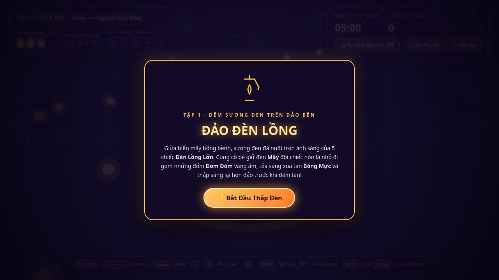
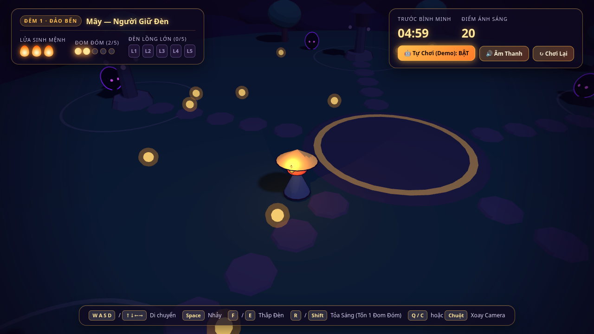
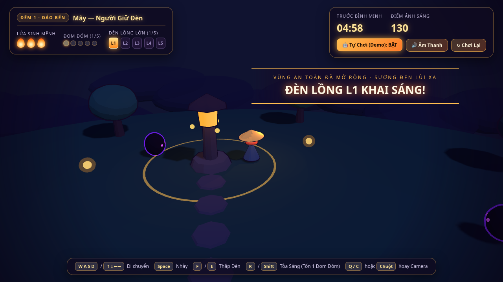
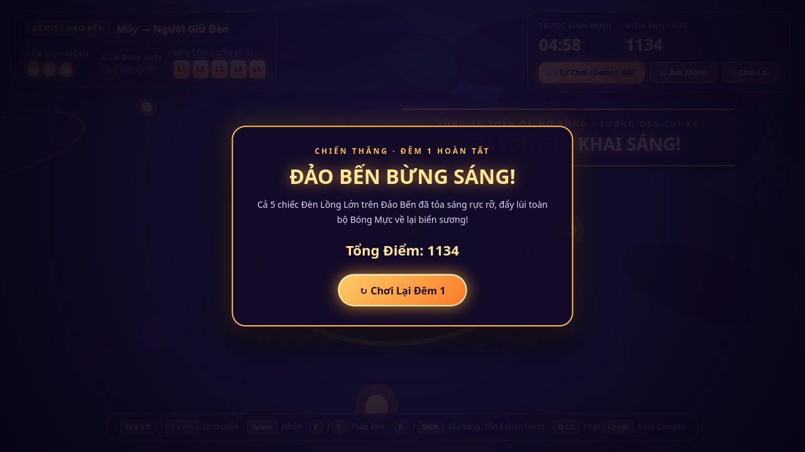

# Bằng chứng Kiểm chứng Phase 1 (Verification & Proof)

Tài liệu này truy vết toàn bộ yêu cầu của **PRD-0** và **Test Contract v1.0** tới bằng chứng thực thi thật tại tag `phase-1`.

---

## 1. Bảng Truy vết Yêu cầu → Bằng chứng → Kết quả

| Mã | Yêu cầu (PRD-0 & Test Contract v1.0) | Cách kiểm chứng | Bằng chứng trong Repo | Kết quả |
|---|---|---|---|---|
| **R1** | Màn Đêm 1 – Đảo Bến có 5 Đèn Lồng Lớn (`L1..L5`), Mây xuất phát tại `(0,0,0)`, `flames = 3`, `time_left_s = 300` | Unit test `test_contract_json_structure` + Snapshot `tick = 0` | `tests/test_contract_phase1.py`, `docs/proof/phase1/win_all_lit_out.jsonl` (dòng 1) | **ĐẠT** |
| **R2** | Di chuyển 3D, nhảy, xoay hướng theo `cam_yaw_deg` (`x' = x·cosθ + z·sinθ`, `z' = -x·sinθ + z·cosθ`), chuẩn hóa vector `move` | Unit test `test_movement_and_cam_yaw_rotation` (120 ticks → `[0.0, 0.0, 12.0]`) | `tests/test_contract_phase1.py`, `docs/proof/phase1/unittest_output.txt` | **ĐẠT** |
| **R3** | Nhặt đom đóm (`mote_picked`) trong `pickup_radius = 1.5m`, giới hạn `carry_capacity = 5` | Scenario `win_all_lit` nhặt 3 đom đóm tại `z = 4, 8, 10` | `docs/proof/phase1/win_all_lit_out.jsonl` (`mote_picked` ở ticks 25, 65, 85) | **ĐẠT** |
| **R4** | Nạp ánh sáng (`deposit`) và thắp đèn (`lantern_lit`) trong `interact_radius = 2.5m` | Scenario `win_all_lit` bấm `interact: true` ở tick 120 tại đèn `L1` | `docs/proof/phase1/win_all_lit_out.jsonl` (`deposit` & `lantern_lit` ở tick 121) | **ĐẠT** |
| **R5** | Bóng Mực đuổi Mây (`shade_speed = 3.2m/s`) và chạm gây mất máu (`player_hit`), rơi `floor(carried * 0.5)` đom đóm, miễn nhiễm trong `invuln_s = 1.5s` | Scenario `lose_no_flames_scenario.json` (`test_lose_no_flames_and_hit_drop`) | `tests/test_contract_phase1.py`, `docs/proof/phase1/unittest_output.txt` | **ĐẠT** |
| **R6** | Tỏa sáng (`pulse`) tốn `pulse_cost = 1`, đẩy lùi `4.0m`, làm choáng `3.0s`; đèn đã thắp chặn Bóng Mực ngoài `safe_radius = 4.0m` | Scenario `pulse_and_safe_zone` (`test_pulse_stun_push_and_safe_radius`) | `docs/proof/phase1/pulse_and_safe_zone_out.jsonl` (S1 bị đẩy từ `z=3` tới rìa `safe_radius` `z=5.0` của L1 ở `z=9`) | **ĐẠT** |
| **R7** | Thắng (`all_lit`), Thua (`no_flames`, `dawn`), cộng điểm và xuất dòng `end` cuối file JSONL | 3 tests: `test_win_all_lit_scenario_cli`, `test_lose_no_flames_and_hit_drop`, `test_lose_dawn` | `docs/proof/phase1/win_all_lit_out.jsonl`, `docs/proof/phase1/unittest_output.txt` | **ĐẠT** |
| **R8** | Tính tất định (cùng `--seed` ra cùng SHA-256) và thoát mã `2` khi file `inputs`/`scenario` sai định dạng | `test_determinism_identical_sha256` & `test_invalid_inputs_or_scenario_returns_exit_code_2` | `docs/proof/phase1/determinism_sha256.txt`, `docs/proof/phase1/unittest_output.txt` | **ĐẠT** |
| **R9** | Đồ họa 3D Anime Cel-Shading (Three.js) + hiệu ứng HUD/Banner (Anime.js), Mây đội nón lá treo đèn lồng, nút Chơi lại | Chạy thật trên trình duyệt headless Firefox qua Playwright (0 lỗi console) và chụp 4 ảnh màn hình | `01_intro_anime_modal.png`, `02_gameplay_3d_anime.png`, `03_lantern_lit_anime_banner.png`, `04_victory_all_lit.png` | **ĐẠT** |

---

## 2. Hình ảnh Bằng chứng Giao diện 3D Anime (Three.js + Anime.js)

1. **Màn hình Mở đầu Tập 1 (Anime.js SVG Line-Drawing & Stagger Reveal):**
   
2. **Gameplay 3D Đảo Bến — Mây đội nón lá tỏa sáng, Đom Đóm và Bóng Mực (Three.js Cel-Shading & Outlines):**
   
3. **Thắp sáng Đèn Lồng Lớn `L1` — Vòng tròn `safe_radius` chặn Bóng Mực ngoài rìa & Banner Anime.js:**
   
4. **Chiến thắng Đêm 1 khi thắp đủ 5 Đèn Lồng Lớn (`all_lit`) và nút Chơi lại:**
   

---

## 3. Lệnh Tái lập Toàn bộ Bằng chứng (Reproducibility)

```bash
# 1. Kiểm tra cú pháp (build_cmd)
python3 -m py_compile headless.py run_game.py src/sim.py

# 2. Chạy bộ kiểm thử tự động (8 test cases)
python3 -m unittest discover -s tests -v

# 3. Kiểm tra tính tất định (Determinism SHA-256)
python3 headless.py --seed 2026 --night 1 --ticks 600 --out /tmp/r1.jsonl
python3 headless.py --seed 2026 --night 1 --ticks 600 --out /tmp/r2.jsonl
sha256sum /tmp/r1.jsonl /tmp/r2.jsonl
```
