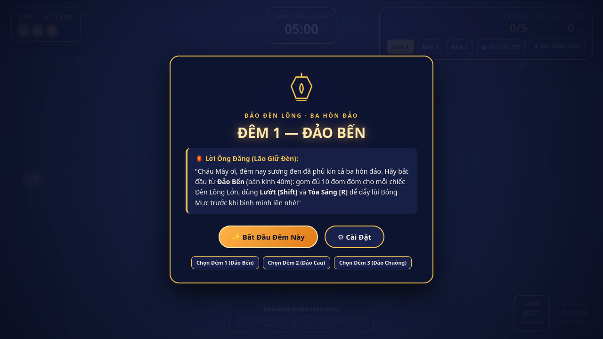
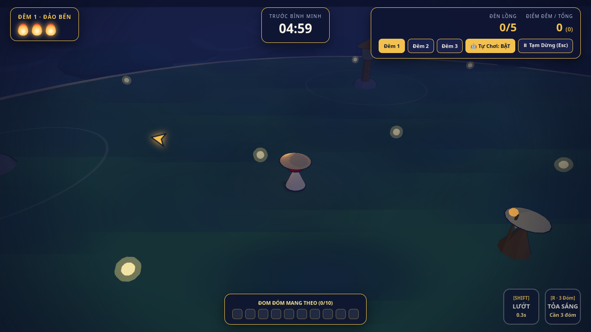
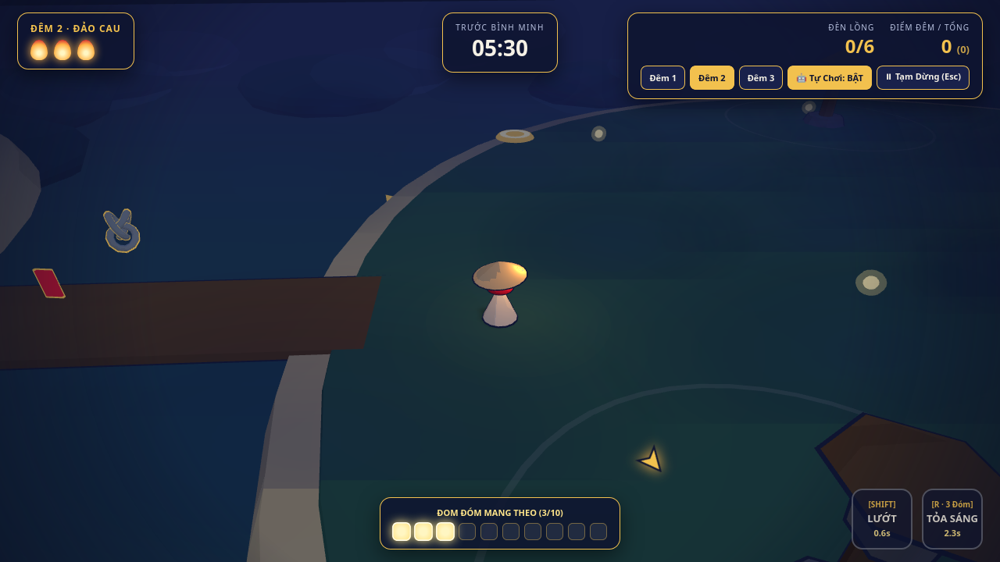
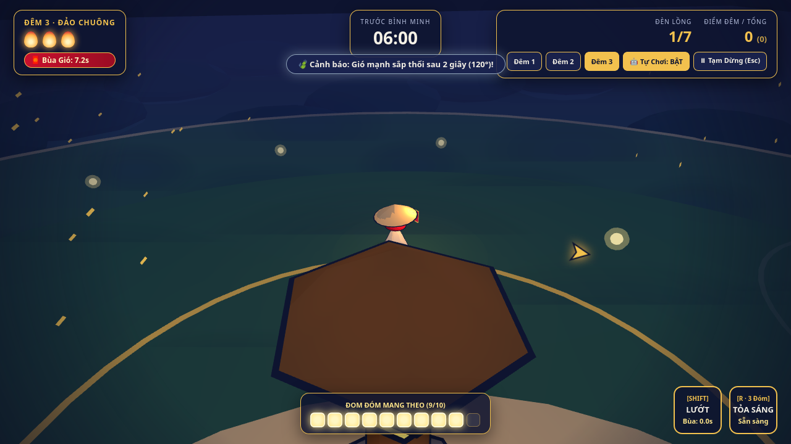

# Bằng chứng Kiểm chứng Phase 2 (TICKET-02 — "Ba hòn đảo" · Contract v1.1)

Tài liệu này truy vết toàn bộ yêu cầu của **TICKET-02 (Phần 1, 2, 3, 4)** tới bằng chứng thực thi thật tại tag `phase-2`.

---

## 1. Bảng Truy vết Yêu cầu → Bằng chứng → Kết quả

| Mã | Yêu cầu (TICKET-02 & Test Contract v1.1) | Cách kiểm chứng | Bằng chứng trong Repo | Kết quả |
|---|---|---|---|---|
| **P2-01** | **Chuẩn hóa số liệu & Bản đồ Đêm 1 (Đảo Bến):** `R=40m`, 5 đèn đúng tọa độ, 20 đom đóm ban đầu (mỗi 240 tick thêm 1 tới trần 30), Bóng Mực sinh 2 con ở tick 300 rồi mỗi 480 tick thêm 1 (tối đa 6) | `test_night1_standardized_map_and_spawns` | `tests/test_contract_phase2.py`, `docs/proof/phase2/unittest_v11_output.txt` | **ĐẠT** |
| **P2-02** | **Lướt (`Dash`):** `14 m/s` trong `0.2 s` (`12` tick), hồi chiêu `1.5 s` (`90` tick từ lúc bắt đầu lướt), giữ độ cao khi lướt trên không, phát event `dash {}` | Scenario `p2_dash_scenario.json` (`test_dash_mechanic_cli`) | `docs/proof/phase2/dash_out.jsonl` (`pos[2] = 2.8m` ở tick 12) | **ĐẠT** |
| **P2-03** | **Rơi khỏi đảo (`Y < -10`) & Hồi sinh:** Bỏ qua bất tử, `-1` Ngọn Lửa, mất hết đom đóm, phát `player_hit {"by":"fall","flames":1,"dropped":0,"lost":4}`, chờ `60` tick rồi hồi sinh ở `(0,0,0)` kèm bất tử `90` tick | Scenario `p2_fall_respawn_scenario.json` (`test_fall_off_island_and_respawn`) | `docs/proof/phase2/fall_respawn_out.jsonl` | **ĐẠT** |
| **P2-04** | **Bị đánh, Đom đóm rơi (`kind="dropped"`) & `recoil`:** Rơi `floor(carried/2)` đom đóm ra vành `1.5–2.5m` (TTL `480` tick), Bóng Mực chuyển sang `recoil` lùi `2m` trong `60` tick | `test_shade_hit_dropped_motes_and_recoil` | `tests/test_contract_phase2.py` | **ĐẠT** |
| **P2-05** | **Đêm 2 — Đảo Cau (2 Đảo `R=28m`, Cầu tre, 2 Bục nhảy, 6 Đèn):** Bục nhảy `(20,0,18)` và `(50,0,-18)` bắn `vy=14, v_xz=24` đáp sang đảo đích | `test_night2_charm_and_jumppad` | `tests/test_contract_phase2.py`, `03_night2_dao_cau_bridge_charm_drifter.png` | **ĐẠT** |
| **P2-06** | **Gió Lạc (`Drifters` — Đêm 2 & 3):** `idle` (`2 m/s`) → `chase` (`7 m/s`) khi `carried >= 5` và `dist <= 15m`; chạm (`<= 1.2m`) cướp `min(3, carried)` (`drifter_steal`), chuyển `flee`; trúng `pulse` khi `flee` có đồ thả lại toàn bộ (`drifter_drop`) | Scenario `p2_drifter_steal_drop_scenario.json` (`test_drifter_steal_and_pulse_drop_cli`) | `docs/proof/phase2/drifter_out.jsonl` | **ĐẠT** |
| **P2-07** | **Bùa Gió (`Charms` — Đêm 2 & 3):** Đêm 2 `(35,0,0)`, Đêm 3 `(30,0,25)` & `(-30,0,25)`. Hiệu lực `600` tick (`7.2 m/s`, Lướt không hồi chiêu), hồi sau `2700` tick, phát `charm_picked` | `test_night2_charm_and_jumppad` | `tests/test_contract_phase2.py`, `03_night2_dao_cau_bridge_charm_drifter.png` | **ĐẠT** |
| **P2-08** | **Đêm 3 — Đảo Chuông (3 Tầng `Y=0/3/6`, 2 Dốc `30°/150°`, Bục nhảy `(0,3,13)`, Tháp Chuông `R=2m`, 7 Đèn, Gió mạnh `2 m/s`):** Bục nhảy phóng `vy=12, vz=-8` đáp lên tầng 2 (`Y=6`) | `test_night3_tiers_ramps_jumppad_and_wind` | `tests/test_contract_phase2.py`, `04_night3_dao_chuong_3tiers_bell_tower.png` | **ĐẠT** |
| **P2-09** | **Tạm dừng (`Pause / Resume`):** Phát `paused {}` / `resumed {}`, `state="paused"`, `tick` tăng nhưng `sim_tick` đứng yên | Scenario `p2_pause_inputs.json` (`test_pause_and_resume_freezes_sim_tick`) | `docs/proof/phase2/pause_out.jsonl` | **ĐẠT** |
| **P2-10** | **Hồi quy Phase 1 & Hiệu năng Headless 21.600 tick `≤ 30s`:** Toàn bộ 8 test Phase 1 + 9 test Phase 2 đạt 100%; chạy 21.600 tick Đêm 3 chỉ mất `~0.95 giây` (`<< 30 giây`) | `test_headless_21600_ticks_performance` | `docs/proof/phase2/unittest_v11_output.txt`, `docs/proof/phase2/determinism_v11_sha256.txt` | **ĐẠT** |

---

## 2. Hình ảnh Bằng chứng 3 Đêm & Giao diện Chuẩn hóa (Three.js + Anime.js)

1. **Màn hình Giới thiệu Đêm & Lời Ông Đăng (Anime.js Cutscene & Chọn Đêm 1/2/3):**
   
2. **Đêm 1 — Đảo Bến (`R=40m`, Bảng màu chuẩn, HUD 10 ô đom đóm, Icon hồi chiêu Lướt & Tỏa Sáng, Mũi tên chỉ đèn ngoài màn hình):**
   
3. **Đêm 2 — Đảo Cau (Cầu tre nối 2 đảo, Bùa Gió `C1` đỏ viền vàng ở `(35,0,0)` và Gió Lạc `D1` dải lụa `#8FA3B8`):**
   
4. **Đêm 3 — Đảo Chuông (3 Tầng `Y=0, 3, 6`, Tháp Chuông 8m ở đỉnh tầng 2, Cảnh báo Gió mạnh & Đồng hồ đỏ nhấp nháy khi `≤ 30s`):**
   
