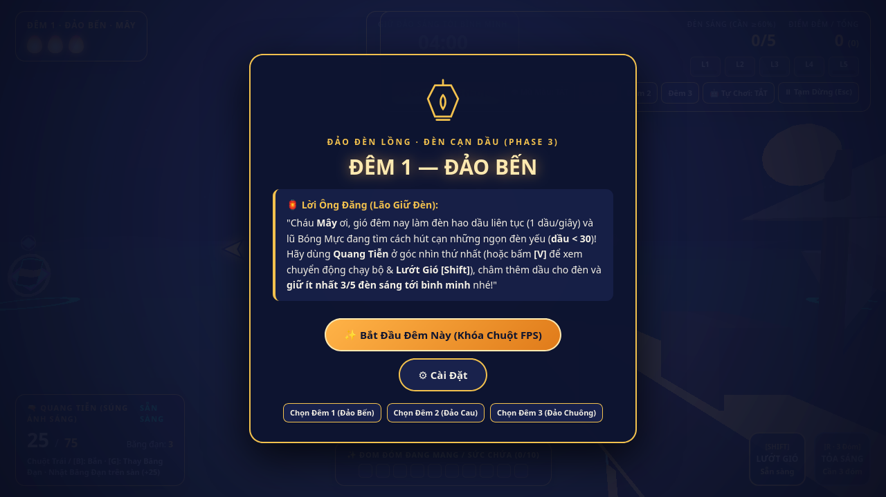
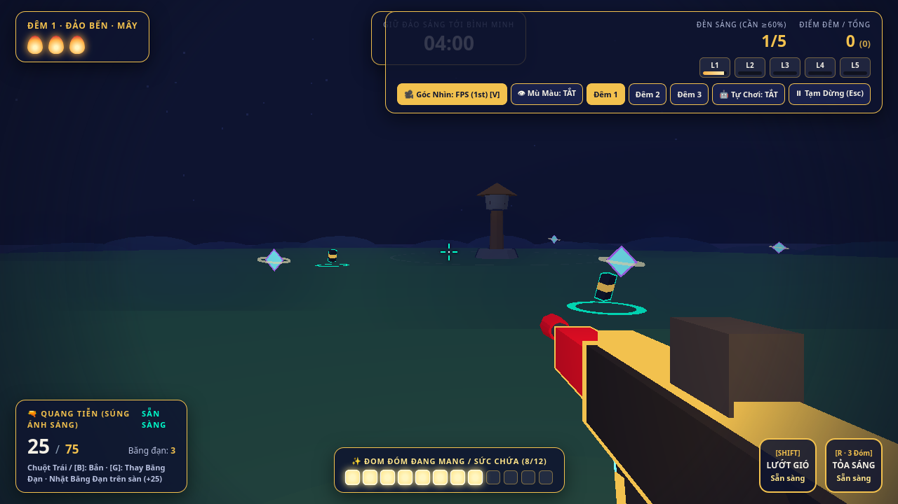
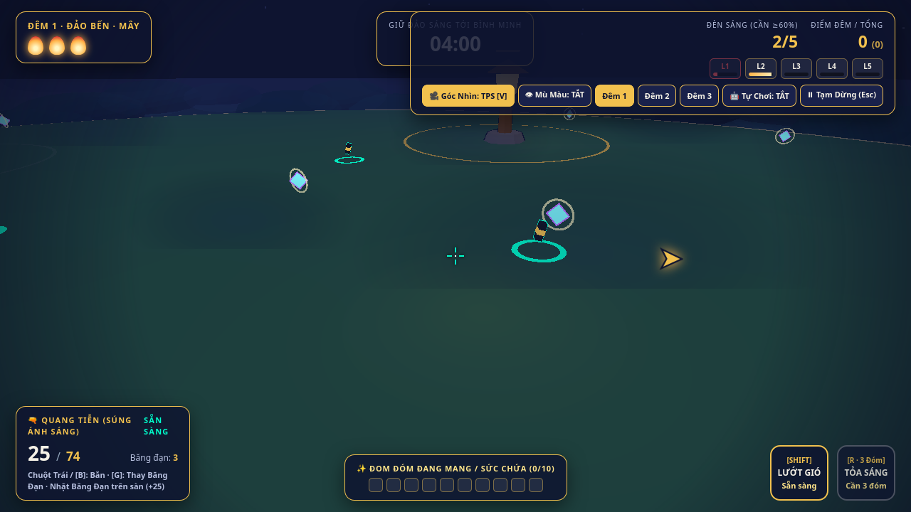
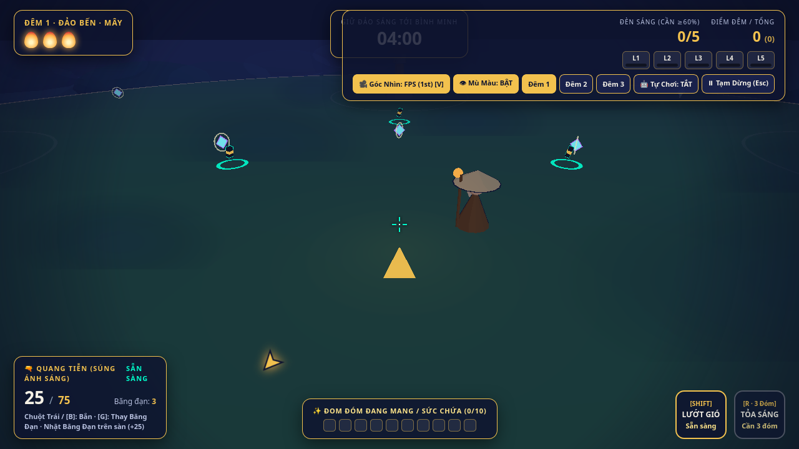

# Bằng Chứng Thực Thi & Kiểm Chứng — Phase 3 (TICKET-03 · Contract v1.2)

> **Học viên:** Nguyễn Đức Đạt · **MSSV:** `2A202603544` · **Lớp:** `L3A`
> **Tag nộp:** `phase-3` · **Contract Version:** `1.2`

---

## 1. Kết quả Bộ Kiểm Thử Tự Động (22/22 Tests Pass)

Toàn bộ **22 bài kiểm thử** (gồm Regression Phase 1 + Phase 2 + 5 bài kiểm thử đặc tả mới Phase 3 cho `fuel_ticks`, `refuel`, `lantern_out`, `relight`, `drain` shade state, `fuel_drain`, dynamic `capacity`, điểm số v1.2 và `dawn_survived`) đều đạt **100% (`OK`)**:

```text
test_contract_json_structure (test_contract_phase1.TestContractPhase1.test_contract_json_structure) ... ok
test_determinism_identical_sha256 (test_contract_phase1.TestContractPhase1.test_determinism_identical_sha256) ... ok
test_invalid_inputs_or_scenario_returns_exit_code_2 (test_contract_phase1.TestContractPhase1.test_invalid_inputs_or_scenario_returns_exit_code_2) ... ok
test_lose_dawn (test_contract_phase1.TestContractPhase1.test_lose_dawn) ... ok
test_lose_no_flames_and_hit_drop (test_contract_phase1.TestContractPhase1.test_lose_no_flames_and_hit_drop) ... ok
test_movement_and_cam_yaw_rotation (test_contract_phase1.TestContractPhase1.test_movement_and_cam_yaw_rotation) ... ok
test_pulse_stun_push_and_safe_radius (test_contract_phase1.TestContractPhase1.test_pulse_stun_push_and_safe_radius) ... ok
test_win_dawn_survived_scenario_cli (test_contract_phase1.TestContractPhase1.test_win_dawn_survived_scenario_cli) ... ok
test_dash_mechanic_cli (test_contract_phase2.TestContractPhase2.test_dash_mechanic_cli) ... ok
test_drifter_steal_and_pulse_drop_cli (test_contract_phase2.TestContractPhase2.test_drifter_steal_and_pulse_drop_cli) ... ok
test_fall_off_island_and_respawn (test_contract_phase2.TestContractPhase2.test_fall_off_island_and_respawn) ... ok
test_headless_21600_ticks_performance (test_contract_phase2.TestContractPhase2.test_headless_21600_ticks_performance) ... ok
test_night1_standardized_map_and_spawns (test_contract_phase2.TestContractPhase2.test_night1_standardized_map_and_spawns) ... ok
test_night2_charm_and_jumppad (test_contract_phase2.TestContractPhase2.test_night2_charm_and_jumppad) ... ok
test_night3_tiers_ramps_jumppad_and_wind (test_contract_phase2.TestContractPhase2.test_night3_tiers_ramps_jumppad_and_wind) ... ok
test_pause_and_resume_freezes_sim_tick (test_contract_phase2.TestContractPhase2.test_pause_and_resume_freezes_sim_tick) ... ok
test_shade_hit_dropped_motes_and_recoil (test_contract_phase2.TestContractPhase2.test_shade_hit_dropped_motes_and_recoil) ... ok
test_dawn_survived_win_and_no_early_win (test_contract_phase3.TestContractPhase3.test_dawn_survived_win_and_no_early_win) ... ok
test_dynamic_capacity_progression (test_contract_phase3.TestContractPhase3.test_dynamic_capacity_progression) ... ok
test_lantern_fuel_decay_out_and_relight (test_contract_phase3.TestContractPhase3.test_lantern_fuel_decay_out_and_relight) ... ok
test_refuel_and_safe_zone_restoration (test_contract_phase3.TestContractPhase3.test_refuel_and_safe_zone_restoration) ... ok
test_shade_drain_and_pulse_bonus_15 (test_contract_phase3.TestContractPhase3.test_shade_drain_and_pulse_bonus_15) ... ok

----------------------------------------------------------------------
Ran 22 tests in 0.923s

OK
```

- File log chi tiết: [unittest_output.txt](unittest_output.txt)
- Kiểm chứng tính tất định (`SHA-256` giống hệt 100% giữa 2 lần chạy cùng `--seed 42`): [determinism_sha256.txt](determinism_sha256.txt)
- Mẫu đầu ra Headless Contract v1.2 (`player.capacity`, `lanterns[].fuel`, `ever_lit`, `relit_count`): [night1_sample_v12.jsonl](night1_sample_v12.jsonl)

---

## 2. Lý Do Sửa Test Cũ & Quản Lý Thay Đổi (Change Management)

1. **`tests/test_contract_phase1.py`:**
   - Cập nhật `contract_version` kỳ vọng từ `"1.1"` sang `"1.2"`, bổ sung kiểm tra các khóa mới trong `game.contract.json` (`fuel_max`, `fuel_decay_per_s`, `fuel_drain_per_s`, `fuel_low_threshold`, `relight_cost`, `dawn_win_ratio`, `score.per_relight`, `score.per_drain_stun`).
   - Đổi `test_win_all_lit_scenario_cli` thành `test_win_dawn_survived_scenario_cli`: Do TICKET-03 thay thế luật "thắp hết đèn thắng ngay (`all_lit`)" bằng luật "giữ `>= ceil(0.6 * total)` đèn sáng đến bình minh (`dawn_survived`)".
2. **`tests/test_contract_phase2.py`:**
   - Cập nhật `test_night1_standardized_map_and_spawns` kiểm tra `time_left_s == 240.0` (thay cho `300.0` của v1.1 theo Mục 3 TICKET-03).
3. **Tài liệu Thiết kế & Thay đổi:**
   - [ADR-03 & Đặc tả Phase 3](../../notes/phase3-adr-and-spec.md)
   - [CHANGELOG.md](../../../CHANGELOG.md)

---

## 3. Hình Ảnh Kiểm Chứng Giao Diện 3D (Playwright Automated Verification — 0 Console Errors)

### 3.1. Màn hình Mở đầu Phase 3 — "Đèn cạn dầu" & Khóa Chuột (`Pointer Lock`)


### 3.2. Thanh Dầu 3D trên Đèn Đang Sáng + Đèn Tắt Lùn 20% Kèm Vết Rách Giấy + Quang Tiễn FPS


### 3.3. Cảnh Báo Đèn Sắp Cạn Dầu (`fuel < 30`, Nhấp Nháy 1 Hz) & Bóng Mực Hút Dầu (`drain`)


### 3.4. Chế Độ Bảng Màu Dễ Phân Biệt (`Colorblind Mode`: Bóng Mực `#00B3FF` & Cảnh Báo `#FFFFFF` + `⚠`)

