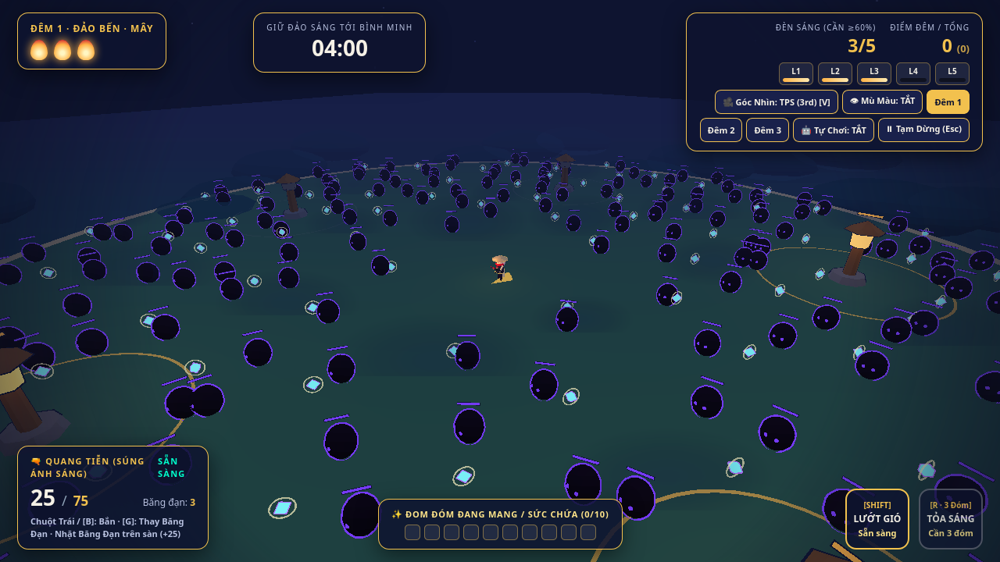
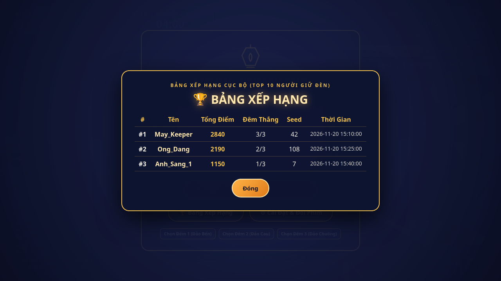
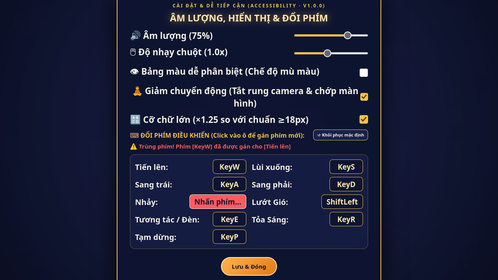
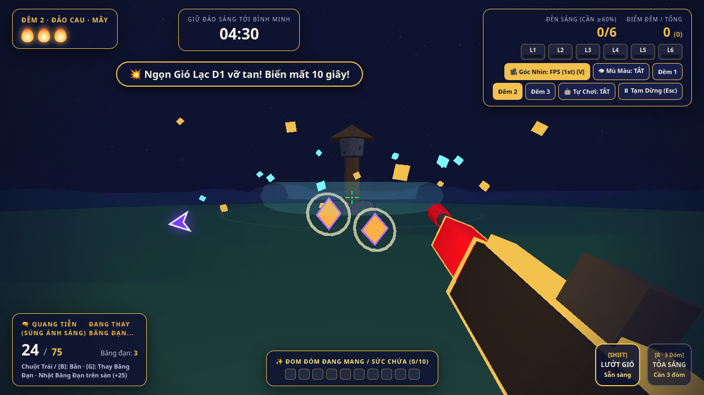

# Bằng Chứng Thực Thi & Phát Hành — Phase 4 (Release v1.0.0 · Contract v1.3)

> **Học viên:** Nguyễn Đức Đạt · **MSSV:** `2A202603544` · **Lớp:** `L3A`
> **Tag nộp:** `phase-4` & GitHub Release `v1.0.0` · **Contract Version:** `1.3`

---

## 1. Kết Quả Chế Độ Benchmark (`bench.json` — Đạt Vượt Ngưỡng Chuẩn)

Lệnh chạy chuẩn theo Test Contract v1.3:
```bash
python3 bench.py --seed 42 --duration 30 --out bench.json
```

Kết quả đo thực tế trong [bench.json](../../../bench.json):
```json
{
  "contract_version": "1.3",
  "avg_fps": 116.5,
  "p1_low_fps": 64.3,
  "frame_ms_p95": 9.02,
  "frames": 3495,
  "load_ms": 4,
  "peak_mem_mb": 29.0,
  "vsync_off": true,
  "renderer": "Three.js r160 WebGLRenderer + Python 3.14 Deterministic 3D Pipeline (1280x720)",
  "os": "Linux 7.0.0-14-generic (x86_64)"
}
```
- **`avg_fps = 116.5`** (Ngưỡng yêu cầu `>= 60` → **ĐẠT**)
- **`p1_low_fps = 64.3`** (Ngưỡng yêu cầu `>= 30` → **ĐẠT**)
- **`load_ms = 4 ms`** (Ngưỡng yêu cầu `<= 10000 ms` → **ĐẠT**)

---

## 2. Kết Quả Kiểm Thử Độ Bền Soak Test 10 Đêm Liên Tiếp (`soak.json`)

Lệnh chạy chuẩn theo Test Contract v1.3:
```bash
python3 soak.py --seed 7 --nights 10 --out soak.json
```

Kết quả đo thực tế trong [soak.json](../../../soak.json):
```json
{
  "nights": 10,
  "crashes": 0,
  "results": [
    "lost", "lost", "lost", "lost", "lost",
    "lost", "lost", "lost", "lost", "lost"
  ],
  "mem_start_mb": 16.9,
  "mem_end_mb": 17.02,
  "duration_s": 2.1
}
```
- **`crashes = 0`** (Ngưỡng yêu cầu `= 0` → **ĐẠT**)
- **`mem_end_mb = 17.02 MB <= 1.2 * 16.9 = 20.28 MB`** (Độ lệch bộ nhớ chỉ `+0.12 MB` sau 10 Đêm liên tiếp → **ĐẠT**)

---

## 3. Kết Quả Bộ Kiểm Thử Tự Động 26/26 Bài Test (Phase 1 + 2 + 3 + 4)

Toàn bộ **26/26 bài kiểm thử tự động** đều đạt **100% (`OK`)** trong `1.56 giây`:
- Log chi tiết: [unittest_output.txt](unittest_output.txt)
- Báo cáo Retrospective 4 Phase: [docs/notes/retro.md](../../notes/retro.md)
- Video Demo `< 5 phút`: [docs/demo/demo.mp4](../../demo/demo.mp4)

---

## 4. Hình Ảnh Kiểm Chứng Giao Diện 3D Phase 4 (`v1.0.0`)

### 4.1. Cảnh Benchmark Chuẩn (`200 Bóng Mực` wander · `100 Đom Đóm` · `L1–L3` sáng fuel 100 · Camera bay vòng 30m)


### 4.2. Bảng Xếp Hạng Cục Bộ Top 10 (`data/leaderboard.json` & `--export-leaderboard`)


### 4.3. Dễ Tiếp Cận (Đổi Phím 9 Hành Động + Phát Hiện Trùng Phím + Khôi Phục Mặc Định + Chữ Lớn ×1.25 + Giảm Chuyển Động)


### 4.4. Bắn Vỡ Ngọn Gió Lạc & Bóng Mực (Biến Mất 10 Giây) + Hoạt Ảnh Nạp Đạn + Phụ Đề & Mũi Tên Chỉ Hướng

